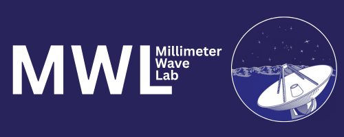
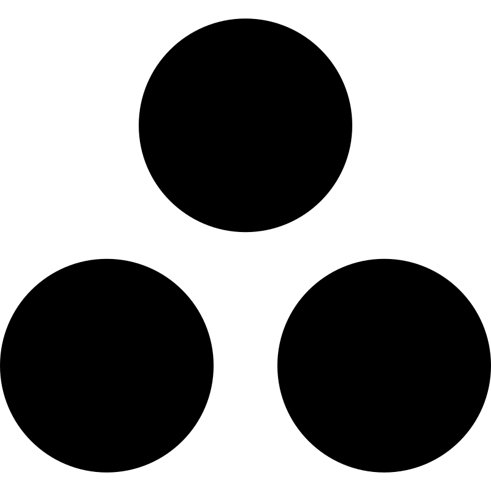

= Manual del Laboratorio de Ondas Milimétricas
:lang: es
:title-page:
:title-logo-image: 
:version-label: Versión
:toc:
:toc-title: Índice
Franco Curotto <fcurotto@das.uchile.cl>
v0.0, 20/10/2026

== Introducción
El siguiente documento es un manual para los ingenierios/as del Laboratorio de Ondas Milimétricas (MWL, Millimeter Wave Laboratory). Incluye la forma de uso de las herramientas digitales, los protocolos y las normas que los integrantes del laboratorio deben seguir durante la ejecución de sus proyectos. El objetivo es estandarizar la documentación y el traspaso de información en el laboratorio.

== Herramientas Digitales
A continuación se presenta un listado de las herramientas digitales oficiales del MWL. Los/as profesional integrantes del laboratorio deben priorizar estas herramientas por sobre otras para el traspaso de la información.

image:images/logos/email.svg[fit=line] Email::
- Acceso: Solicitar la creación de un mail *@das.uchile.cl* al Coordinador del Laboratorio.
- Uso:
image:images/logos/discord.svg[fit=line] Discord::
- Acceso: Crear una cuenta con mail *@das* en https://discord.com, luego solicitar acceso a los servidores al Coordinador del Laboratorio.
- Uso:
 Asana::
- Acceso: Crear una cuenta con mail *@das* en https://asana.com, luego solicitar acces a los proyectos al Coordinador del Laboratorio.
- Uso: 

image:images/logos/github.svg[fit=line] GitHub::
- Acceso: Crear una cuenta con mail *@das* en https://github.com, luego solicitar ingreso a la institución millimeter-wave-lab al Coordinador del Laboratorio.
- Uso:
image:images/logos/gdrive.svg[fit=line] Google Drive::
- Acceso: Solicitar acceso al drive asociado al mail mwl@raig.uchile.cl a través del mail *@das* al Coordinador del Laboratorio.
- Uso:

== Reglas Generales de Laboratorio

== Administración de Tareas

== Administración de Archivos Digitales

=== Códigos de Fuente

=== Diseños Electrónicos

=== Otros Tipos de Archivos
