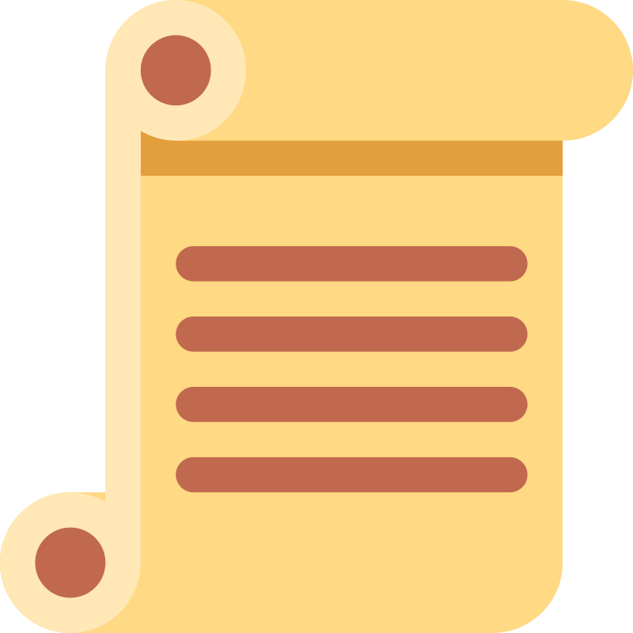

= Millimeter-Wave Laboratory Engineer's Manual
:title-page:
:title-logo-image: image:images/logos/mwl-v2.1.png[top=5%,align=left,pdfwidth=6cm]
:toc:
Franco Curotto <fcurotto@das.uchile.cl>
v1.0, {docdate}

// definitions
:iconwidth: 16
:email:  Email
:discord: https://discord.com[ Discord]
:asana: https://asana.com[image:images/logos/asana.png[width={iconwidth}] Asana]
:github: https://github.com[image:images/logos/github.svg[width={iconwidth}] GitHub]
:gdrive: https://drive.google.com[image:images/logos/gdrive.svg[width={iconwidth}] Google Drive]
:gcalendar: https://calendar.google.com[image:images/logos/gcalendar.svg[width={iconwidth}] Google Calendar]
:rule: 

// modifications
// remove example captions in order to make custom blocks (like Rule)
:example-caption!:

== Introduction
This document is a manual for engineers working at the Millimeter-Wave Laboratory (MWL) in the Astronomy Department (DAS) of the University of Chile. It describes the web tools, laboratory protocols, and rules that lab members must follow while carrying out their projects. Its objective is to standardize information channels and documentation within the laboratory.

== Relevant People
If you have a question or request concerning the operation of the Millimeter-Wave Laboratory, please contact one of the following people:

- Ricardo Finger <rfinger@das.uchile.cl>: Laboratory Director
- Leonardo Bronfman <leo@das.uchile.cl>: Laboratory Leader Emeritus
- Franco Curotto <fcurotto@das.uchile.cl>: Laboratory Manager

== Web Tools
The following are the official web tools used at the MWL. Lab members should prioritize these tools when sharing project-related information.

{email}::
*Access:* Ask the Laboratory Manager to create an *@das.uchile.cl* email account (also referred to as an *@das* account). Also ask for the account to be added to the *todos@das.uchile.cl* and *instrumentacion@das.uchile.cl* mailing lists. +
*Uses:* Official laboratory and department communications and general announcements.
{discord}::
*Access:* Create an account at https://discord.com using your *@das* email address, then ask the Laboratory Manager for access to the relevant project servers. +
*Uses:* Quick project discussions and updates. Informal announcements. Sharing preliminary results that do not need to be backed up. Coordinating meetings, off-site work, and laboratory visits.
{asana}::
*Access:* Create an account at https://asana.com using your *@das* email address, then ask the Laboratory Manager for access to the relevant project pages. +
*Uses:* Management and tracking of project tasks.
{github}::
*Access:* Create an account at https://github.com using your *@das* email address, then ask the Laboratory Manager for access to the https://github.com/millimeter-wave-lab[millimeter-wave-lab] GitHub organization. +
*Uses:* Backing up, managing, and documenting project source code and electronic designs.
{gdrive}::
*Access:* Use your *@das* email address to ask the Laboratory Manager for access to the MWL drive associated with mwl@raig.uchile.cl. +
*Uses:* Backing up general digital files that cannot be managed with Git or are too large to store in GitHub. Examples include mechanical designs, documents, images, and videos. The drive is also used to store final documentation of project designs and results.
{gcalendar}::
*Access:* You can find the link to the MWL Google Calendar in the `#links` channel of our {discord} server. +
*Uses:* Sharing of lab events.

== General Lab Rules
The following rules apply to all engineers and students working in the laboratory.

.{rule} Rule 1 - *Supervisors*
====
Every engineer *must have a supervisor* whom they can consult and with whom they can confirm information. By default, the supervisor is the Laboratory Manager.
====

.{rule} Rule 2 - *Equipment*
====
Every engineer *must receive training* from their supervisor at least once before beginning work in the laboratory. For specialized equipment (such as vector network analyzers and circuit board plotters), the following 1-2-3 rule applies:

1. The first time, the supervisor demonstrates how to use the equipment while the trainee observes and takes notes.
2. The second time, the trainee operates the equipment while the supervisor monitors its correct operation.
3. The third time, the trainee may use the equipment without supervision, provided the supervisor considers them sufficiently competent to do so. The trainee must be able to contact the supervisor if they encounter a problem or have a question.
====

.{rule} Rule 3 - *Accidents*
====
Accidents and near misses that cause, or could have caused, injury or damage to laboratory equipment *must be reported* to the supervisor immediately.
====

.{rule} Rule 4 - *Order*
====
After each experiment and at the end of each workday, every engineer *must return all equipment, devices, tools, connectors, and cables* to their designated locations. If the same setup is needed the following day, it may be left in place. However, all devices and tools that are not part of the setup must be returned to their designated locations.
====

.{rule} Rule 5 - *Faulty Equipment*
====
If an engineer finds faulty equipment or a malfunctioning device, they *must report it* to the supervisor immediately, even if they did not cause the fault. Once the fault has been identified and reported, the equipment must be *labeled with a sticker* describing the problem. If an engineer finds a damaged cable, they must be removed from service, cut it and dispose of it.
====

.{rule} Rule 6 - *Cleaning*
====
It is the responsibility of each engineer to *keep their work area clean* and free of dust after every experiment.
====

.{rule} Rule 7 - *Food*
====
*No food or drinks are allowed* inside the laboratory.
====

== Task Management
Platform::
All laboratory project tasks are managed using the {asana} web platform.
Tasks::
Tasks should generally be defined during coordination meetings with the project supervisor. Engineers may also create additional tasks when necessary, provided that doing so does not modify existing tasks.
Responsibility::
*Each engineer is responsible for registering their tasks and keeping them up to date*.
Updates::
{asana} must be updated at least once a week. Any changes to tasks must be discussed with the project supervisor.
Attributes::
The following attributes must be entered and kept up to date for each task:
- Name and description
- Project
- Assignee
- Due date
- Priority
Task Start Date::
A task's start date is the date is assigned to an engineer.
Completed Tasks::
Tasks must be marked as "`completed`" as soon as possible after the work is finished.

== Digital File Management
This section describes how engineers should manage the digital files generated during their work. It is divided into three categories: *source code*, *electronic designs*, and *other files*.

=== Source Code
Platform::
All source code written for laboratory projects must be managed using https://git-scm.com[Git] and backed up regularly to the MWL {github} organization at https://github.com/millimeter-wave-lab.
Git::
Using https://git-scm.com[Git] correctly is essential for developing and maintaining source code. Engineers should follow Git best practices, such as those described in https://dev.to/aneeqakhan/best-practices-for-git-and-version-control-588m.
Repositories::
Each engineer is responsible for organizing project code clearly within repositories. Repository names must follow this convention: `<PROJECT>-<RepositoryName>` (note the capitalization).
Committing::
Coding tasks in {asana} should be marked as completed only after the relevant code has been committed and pushed to the {github} repository.
Project Structure::
Project source code should be organized in a clearly defined directory structure, such as the examples described in https://thiraphat-ps-dev.medium.com/exploring-project-structure-templates-examples-and-best-practices-15855c333a71.
Coding Style::
The laboratory does not impose a specific https://en.wikipedia.org/wiki/Programming_style[coding style] for project code. However, engineers are encouraged to follow official or widely adopted style guides for each language. For example, Python's official style guide is PEP 8: https://peps.python.org/pep-0008/. The use of https://www.jetbrains.com/pages/static-code-analysis-guide/linters/[linters] is also encouraged. For Python, for example, we recommend https://realpython.com/ruff-python/[Ruff].
AI::
AI tools for coding (including large language models and agents) may be used in laboratory projects. However, each engineer is responsible for understanding AI-generated code and ensuring that it is safe, robust, and maintainable. Engineers must also be able to modify and run the code without relying on AI tools.

=== Electronic Designs
Software::
The laboratory does not mandate a specific software suite for electronic design. However, http://kicad.org[KiCad] is recommended because it is free and open source. Engineers may use other software, provided they have access to it and can export the project to KiCad.
Backups::
Like source code, electronic designs should be backed up regularly to {github} and follow the repository naming convention `<PROJECT>-<RepositoryName>`. Schematics, PCB layouts, manufacturing output, and other files produced during the design process should be included in the repository. The following is an example of a recommended repository structure:
----
my_project/
├── my_project.kicad_pro
├── my_project.kicad_sch
├── my_project.kicad_pcb
├── README.md
├── docs/
│   ├── schematic.pdf
│   ├── pcb-assembly.pdf
│   ├── bom.csv
│   ├── board-3d.png
│   └── test-procedure.md
└── manufacturing/
    ├── gerbers/
    └── drill/
----

Avoid backing up files manually on {gdrive}, unless the project is considered finished or archived.

=== Other Files
Backups::
For other technical projects, such as mechanical designs and electromagnetic simulations, that involve large files unsuitable for Git, use {gdrive} for backups. Create a folder named after the project inside the `Projects` folder and store all relevant files there. The project documentation should also be kept in this folder.
Versioning::
Different design iterations should be kept in separate folders, preferably using a version identifier such as `v1.0` or `iteration-2`.

=== Documentation
Code and Electronics::
Documentation for source code and electronic designs must be kept in their respective {github} repositories. We recommend storing it in a dedicated `docs/` folder and writing it in https://www.markdownguide.org/[Markdown] or https://asciidoc.org/[AsciiDoc].
Other Projects::
For other projects backed up using {gdrive}, documentation must be stored in the same project folder. We recommend using a dedicated `docs/` folder. Documentation may be written in Google Docs or Markdown.
Reports::
Final reports, manuals, tutorials, and handover documents must be saved as PDF files in the appropriate project folder in {gdrive}. Each document must include the author's name and the date of revision.
[WARNING]
====
A standard format for this type of documentation is being developed. Once it is ready, it will be included in the next version of this manual.
====

== Telework Rules
Telework days::
Engineers may work remotely up to two days per week.
Request::
Telework requests must be submitted in the `#telework` channel on {discord}. The Laboratory Manager will approve or reject each request in the same channel.
Conditions::
. The engineer must have tasks that can be performed remotely and that justify a full day's work.
. Those tasks must be registered in {asana}.
. The engineer must not have higher-priority laboratory tasks scheduled for that week.
. The engineer must submit the request at least one day in advance and receive approval before the remote-work day begins.
. Telework cannot be requested for days when the coordination meeting takes place (Mondays).

== Field Visit Rules
When a project requires engineers to make a technical field visit, usually to install, repair, or maintain a system, they must follow the rules below.

Before the Visit::
. The engineer must inform the project supervisor and Laboratory Manager of the visit date and objectives.
. The engineer must prepare a _Visit Plan_ describing the visit objectives, the tasks required to achieve them, and the tools and equipment to be taken. The plan may be a PDF document or a detailed message in {discord}.
. The engineer must identify and obtain all personal protective equipment (PPE) required for the visit. If any required PPE is unavailable, the engineer must contact the Laboratory Manager to resolve the issue.
. The engineer should coordinate with the Laboratory Manager to arrange for another engineer to accompany them when necessary.
. If a device or system is to be installed, the engineer must verify that it is functioning correctly and complies with the applicable standards and requirements of the host institution.
. If equipment is to be taken to the visit, the engineer must confirm that it is functioning correctly before departure.
During the Visit::
. The engineer must take photographs and videos during the visit to document the work performed.
. In particular, the engineer must photograph the final setup after completing the work.
. If an accident or near miss occurs, or if a device is damaged, the engineer must report it immediately to the Laboratory Manager.
After the Visit::
. The engineer must prepare a _Visit Report_ describing the results of the visit, any discussion of next steps, and any other relevant information. The report may be a PDF document or a detailed message in {discord}.
. The engineer must return all tools and PPE taken on the visit to their designated locations in the laboratory.

== Performance Reviews
Definition::
The performance review is the process by which the Laboratory Director and Laboratory Manager assess each engineer's performance, considering their technical output and overall engineering work.
Dates::
Performance reviews should take place at least once every six months.
Evaluation::
The performance review consists of two types of evaluation: a _quantitative evaluation_ and a _qualitative evaluation_.
Quantitative evaluation::
The quantitative evaluation is generated automatically by processing each engineer's tasks registered in {asana}. A performance score is calculated for each task, and an overall score is then calculated for the engineer over the evaluation period.
Performance Score::
The performance score of a task is computed as a percentage with the following formula: +
 +
`Task Score = (workdays allocated to the task) / (workdays spent on the task) [%]` +
 +
Thus, 100% means that the task was completed within the expected number of workdays; 50% means that it took twice the expected time; and 200% means that it took half the expected time.
Total Performance::
A total performance score can be calculated as the weighted sum of the score of all the assigned tasks. This can be shown to be equivalent to: +
 +
`Total Score = (Σ workdays allocated to the task) / (Σ workdays in the task) [%]` +
 +
Where Σ denotes the sum across all tasks assigned to an engineer.
Qualitative Review::
In addition, a qualitative review is conducted in which the engineer is evaluated on the following criteria:
- Technical complexity of tasks
- Autonomy
- Work quality
- Problem resolution skills
- Technical documentation
- Collaboration
- Planning and organization

== Version History
[options="header"]
|=======================
|Version | Date       | Details
| v1.0   | 2026-11-19 | Initial release.
|=======================
