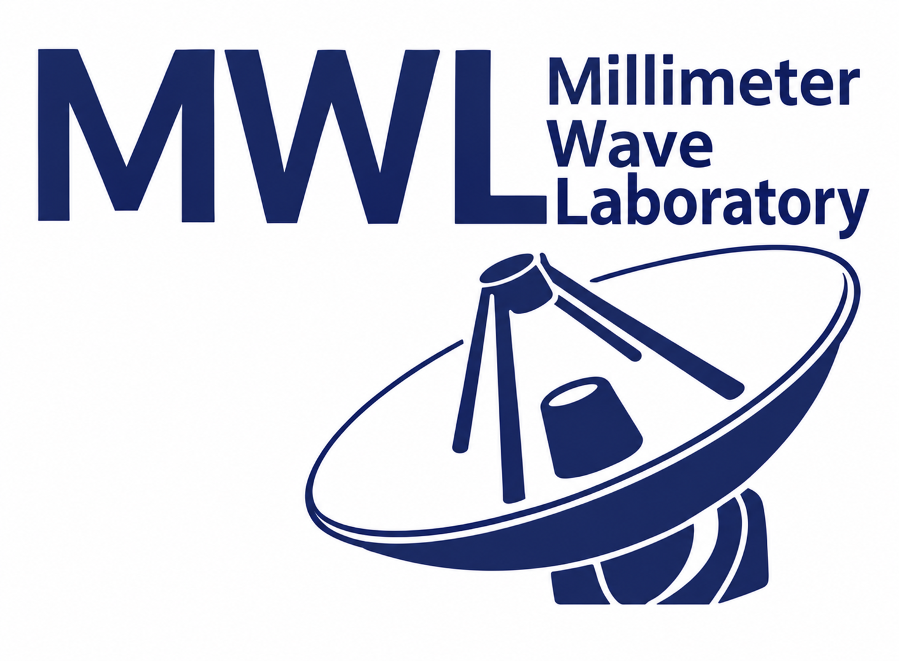
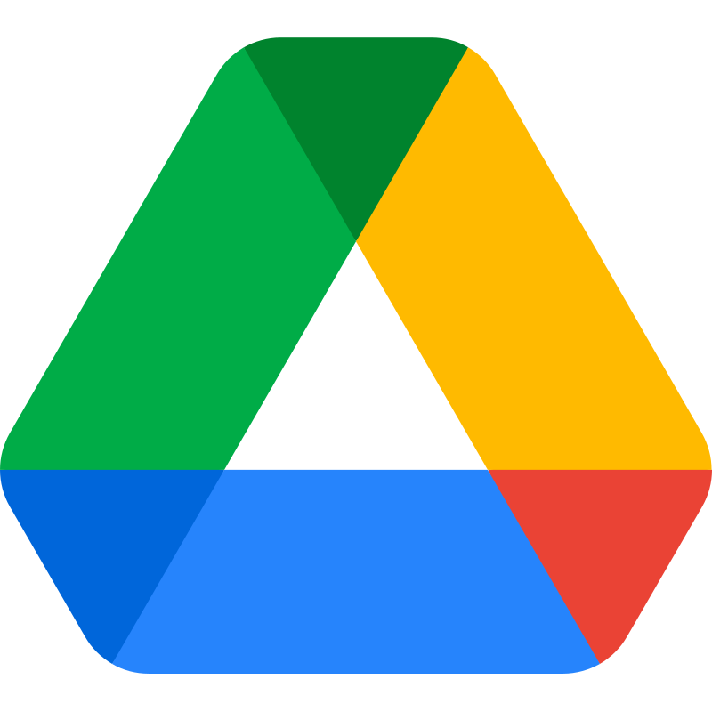
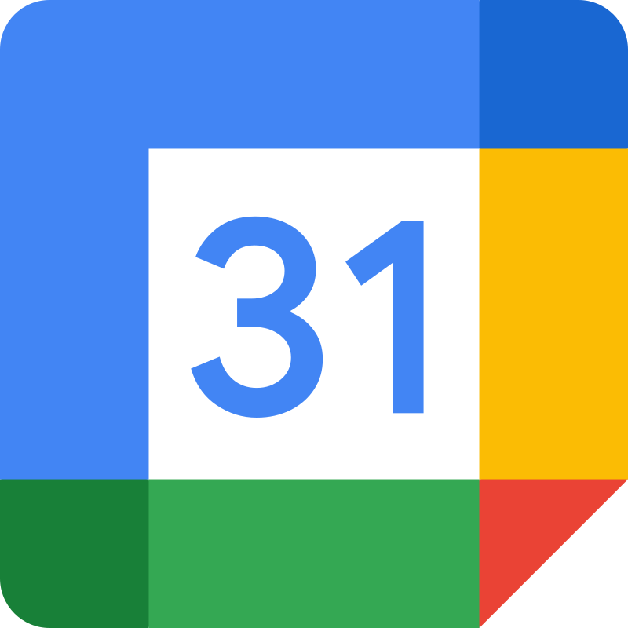

= Millimeter-Wave Laboratory Engineer's Manual
:title-page:
:title-logo-image: 
:toc:
Franco Curotto <fcurotto@das.uchile.cl>
v0.0, 20/10/2026

// definitions
:iconwidth: 16
:email: image:images/logos/email.svg[width={iconwidth}] Email
:discord: https://discord.com[image:images/logos/discord.svg[width={iconwidth}] Discord]
:asana: https://asana.com[ Asana]
:github: https://github.com[ GitHub]
:gdrive: https://drive.google.com[ Google Drive]
:gcalendar: https://calendar.google.com[ Google Calendar]
:rule: image:images/emojis/rule.svg[width={iconwidth}]

// modifications
// remove example captions in order to make custom blocks (like Rule)
:example-caption!:

== Introduction
The following document is a manual for the engineers working at the Millimeter-Wave Laboratory (MWL) located in the Astronomy Department (DAS) of the University of Chile. It includes the use of the web tools, laboratory protocols and rules the lab members must follow during the execution of their projects. The document objective is to standardize the information channels and documentation within the laboratory.

== Relevant People
If you ever have a question or request about the Millimeter-Wave Laboratory operation, please contact one of the following people:

- Ricardo Finger <rfinger@das.uchile.cl>: Laboratory Director
- Leonardo Bronfman <leo@das.uchile.cl>: Emeritus Laboratory Leader
- Franco Curotto <fcurotto@das.uchile.cl>: Laboratory Manager

== Web Tools
Below there is a list of the official web tools used at the MWL. The lab members must prioritize the use of these tools over others for the sharing of relevant information of their projects.

{email}::
*Access:* Request the creation of an *@das.uchile.cl* (also called *@das*) to the Lab Manager. Also request for the created email to join the *todos@das.uchile.cl* and the *instrumentacion@das.uchile.cl* mail groups. +
*Uses:* Official laboratory and department information. General announcements.
{discord}::
*Access:* Create an account with the *@das* email at https://discord.com, then request access to the relevant project servers to the Lab Manager. +
*Uses:* Quick discussions and updates on projects. Informal announcements. Sharing of initial and partial results (which don't need backup). Coordination of meetings, off-site work trips, and lab visits.
{asana}::
*Access:* Create and account with the *@das* email at https://asana.com, then request access to the relevant projects pages to the Lab Manager. +
*Uses:* Management and tracking of project tasks.
{github}::
*Access:* Create an account with your *@das* email at https://github.com, then request access to the GitHub organization `millimeter-wave-lab` to the Lab Manager. +
*Uses:* Backup, management and documentation of source code, and electronic designs for projects.
{gdrive}::
*Access:* Request access to the MWL drive linked to the mwl@raig.uchile.cl email through the *@das* email to the Lab Manager. +
*Uses:* Backup of general digital files that cannot be managed with git, or are too big to backup in GitHub. Examples: mechanical designs, documents, images, videos, etc). Documentation of final designs and results for projects.
{gcalendar}::
Access: Add the lab calendar to your preferred calendar app via this link: https://calendar.google.com/calendar/u/0?cid=bXdsQHJhaWcudWNoaWxlLmNs +
*Uses:* Sharing of lab events.

== General Lab Rules
Below is a list of rules that every member must follow when working inside de laboratory.

.{rule} Rule 1 - *Supervisors*
====
Every person working on the lab *must have a supervisor*, to which they may ask and confirm information. By default, the supervisor is the lab manager.
====

.{rule} Rule 2 - *Equipment*
====
Every person working on the lab *must receive training* from their supervisor at least once before the start of their work in the lab. For specialized equipment (Vector Network Analyzers, Circuit Board Plotters,etc.) we follow the 1-2-3 rule:

1. The first time, the supervisor teaches the person how to use the equipment. The person sees and takes notes.
2. The second time, the person uses the equipment and the supervisor monitors it correct operation.
3. The third time, the person is allowed to use the equipment without supervision, assuming he/she can contact the supervisor in case of every trouble or question.
====

.{rule} Rule 3 - *Accidents*
====
Accidents and near-accidents that may have caused damage to the lab equipment or people *must be reported* immediately to the supervisor.
====

.{rule} Rule 4 - *Order*
====
After each experiment and each day of work every worker *must return all the equipment, devices, tools, connectors and cables* to their original location. If the worker must continue to use the same setup for the next day, he/she is allowed to keep the equipment in its setup position, however, all devices and tools not part of the setup must be returned to their original location.
====

.{rule} Rule 5 - *Faulty Equipment*
====
If the worker finds a faulty equipment or device, he/she *must report it*  immediately to the supervisor, even if the fault was not the responsibility of the worker. After the fault was idenfied and reported, the equipment must be *labeled with a sticker* describing the fault. If the worker finds a faulty cable, he/she must cut the cable and dispose it.
====

.{rule} Rule 6 - *Cleaning*
====
Its responsibility of each worker to *keep their working area clean* and free of dust after every experiment.
====

.{rule} Rule 7 - *Food*
====
*No food or drinks are allowed* inside the laboratory.
====

== Tasks Management
All project's tasks in the lab are managed with the web platform {asana}. *Each engineer is responsible to register and keep up to date all of their tasks*. The {asana} should be updated at least on a weekly basis. Tasks should generally arise from the coordination meetings with the project supervisor, but the engineers are allowed to create additional tasks if they see it is convenient as long as the other tasks are not modified. Any modification of the tasks must be discussed with the project supervisor. For each task, the following attributes must be created and updated properly:

- Name and description
- Project
- Assignee
- End date

Additionally, tasks must be marked as "`completed`" as soon as possible after completion. It is assumed that work on tasks start the day they are assigned to an engineer. During performance reviews the engineering "`performance`" on tasks is used to aid the review. The task performance, is computed as:

Task Performance = (work days assigned to task) / (work days duration of task) [%]

So 100% means the task was completed in the expected amount of days, 50% means that the task needed twice the amount of days to complete, and 200% means that the tasks was completed in half the required time.

A "`total performance`" measure can be computed as the weighted sum of the performance of all the assigned tasks. This can be shown to be equivalent to:

Total Performance = (Σ work days assigned to task) / (Σ work days duration of tasks) [%]

Where the symbol Σ means the summation across all tasks assigned to an engineer.

Even though engineers' work cannot be completely summarized by a single number, the performance metric is an important part to assess the work contribution of each engineer and detect improvement points in our organization. So it's essential that each engineer manages their tasks responsibly.

== Digital Files Management
This section describes the engineer should manages all the types of digital files generated during their work. It's divided in _source code_, _electronic design_, _documentation_ and _other files_.

=== Source Code
All source code written for the lab projects must be managed using https://git-scm.com[git], and must be backed up regularly in our own {github} organization at https://github.com/millimeter-wave-lab. Each engineer is responsible to neatly organize their project code in repositories. The standard naming for repositories must be: `<PROJECT>-<RepositoryName>` (notice the case convention used).

Tasks in {asana} relating to coding should not be marked as completed until the relevant code is "`pushed`" to the {github} repository.

==== Style Guidelines

==== AI Usage

=== Electronic Designs

=== Documentation

=== Other Files

== Telework Rules

== Field Visit Rules

== Performance Reviews
